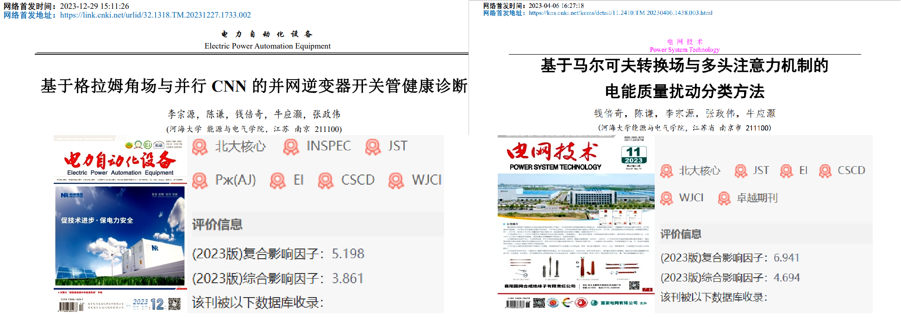
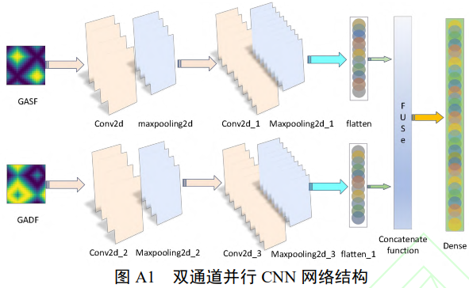
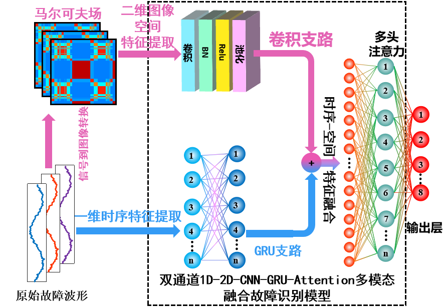
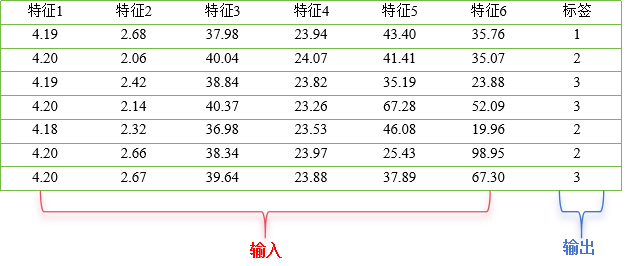
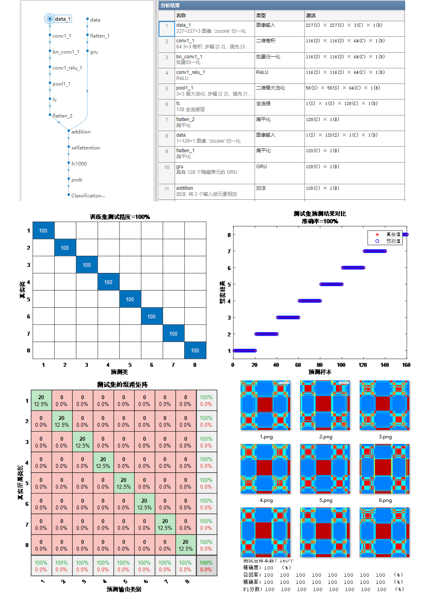
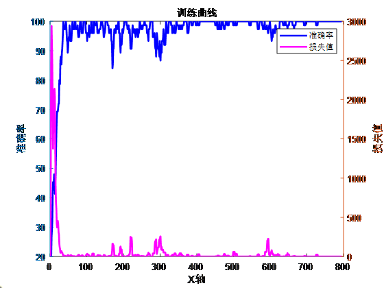

# Strong! Directly publish the document! Classification/Fault Identification Program for Multi-Channel Image Time Series Fusion with 1D-2D-MTF-CNN-GRU-AT! Import via Excel, directly run.

Applicable Platform: Matlab 2023 version and above.
① Chinese EI journal "Electric Power Automation Equipment" online first issue on December 29th: "Healthy Diagnosis of Inverter Switching Devices Based on Gram-Lanczos Field and Parallel CNN"
② Chinese EI journal "Power Grid Technology" online first-time literature: "Classification Method of Power Quality Disturbance Based on Markov Transition Field and Multi-Head Attention Mechanism"
\n     \n    Furthermore, on this basis, the model is further combined to enhance its advantages. The program comments are clear and informative, providing valuable insights. Below is a brief introduction to the article and the program!
Document 1 Interpretation: In this document, firstly, a time-sequential sequence of one-dimensional fault voltage and current signals is collected. Secondly, by using the Gram angle field transformation, two one-dimensional time-series signals are transformed into the Gram angle field. Finally, the generated two sets of images are simultaneously fed into a CNN for parallel learning and training to achieve inverter fault diagnosis.
Innovation Point: The dual-route feature extraction structure can achieve the extraction of features with different focuses separately, realizing the complementary features of dual-route.
\n    Documentation ② Interpretation: The innovation of this document lies in the combination of Markov Field (MTF) and Convolutional Neural Networks (CNN), incorporating multi-head attention mechanisms to achieve fault classification. MTF transforms one-dimensional signals into two-dimensional feature maps, while CNN can perform adaptive feature extraction and classification on these feature maps. The integration of multi-head attention mechanisms effectively captures the contribution of extracted features, achieving accurate classification of faults.
Innovation Point: By expressing the state transition matrix in sequence, it fully preserves the discrete-time dynamic information. Ultimately, it utilizes a fuzzy kernel to aggregate and generate two-dimensional images, which visualize one-dimensional time series data. This approach more effectively captures complex waveform patterns and anomalies.
\n        \n      Model Integration Improvement: We propose a model that combines the advantages of the above-mentioned models.
Model complementarity:
References:
1. Reference ①: The product is manufactured using a dual-route structure, where different routes are utilized to extract features with different focuses, achieving complementary features through the dual-route approach.
2. Reference ②: With only raw fault waveform data, it is possible to convert a one-dimensional sequence into a two-dimensional Markov Field (MTF) image based on the waveform data.
Model improvement:
One route extracts Gram angle field image features from the input image via CNN, while the other route directly inputs fault waveforms for time series feature extraction using GRU. This merges high-dimensional image features and one-dimensional time series features.
The integration of multi-head attention mechanism effectively captures the contribution of extracted features, enhancing focus and improving the accuracy of fault identification. Evaluation metrics such as precision, recall, accuracy, F1 score are calculated. The fault identification process is as follows:

Six innovative points:
1. Multimodal fusion: Merging one-dimensional time series signals and two-dimensional images allows for the comprehensive use of information from different modalities, thereby more comprehensively describing the characteristics of the data. This helps in extracting richer and more distinctive features, thereby enhancing classification and recognition accuracy.
2. Time series information capture: GRU (Gated Recurrent Unit) is a type of recurrent neural network suitable for time series data. It can capture dynamic changes and trends within one-dimensional time series signals. By integrating GRU with CNN, the algorithm can consider both time series and spatial features simultaneously, further improving its performance.
3. Spatial feature learning: CNN (Convolutional Neural Network) performs excellently in image processing, effectively learning spatial features and local patterns of images. Applying CNN to image data processing can help extract texture, shape, and edge features of images, aiding in more accurate classification and fault identification.
4. Integration advantage: By integrating information from different modalities, the algorithm can compensate for the limitations of one-dimensional time series signals and two-dimensional images. For example, an image may be more sensitive to certain fault modes, while a time series signal may be more sensitive to others. Combining them together can enhance the algorithm's robustness and generalization capabilities.
5. Multi-head Self-Attention Mechanism: This mechanism effectively captures the contribution of features, focusing on key points to enhance fault identification accuracy.
6. Improved Generalization Ability: The integration of multimodality can help algorithms better understand the essential characteristics of data, thereby reducing the risk of overfitting and enhancing the algorithm's generalization ability on new data.
Applicable Fields: Suitable for various data classification scenarios such as rolling bearing faults, transformer oil gas faults, fault detection areas in power system transmission lines, insulators, distribution networks, and disturbances in electric energy quality, etc., for recognition, diagnosis, and classification.
Direct replacement of data is possible; simply import it into an Excel table without needing significant modifications to the program. The program includes detailed comments for ease of understanding the program's operation.
Data Format: Each row represents a sample, with the last column being the fault type label for that sample.

## Images

<!-- PAYMENT_BLOCK -->

## Get this dataset

- Payment link (Stripe): [Buy now](https://buy.stripe.com/3cs8yP7sY87d0vu9AB)
- Payment QR code: 

<!-- /PAYMENT_BLOCK -->
